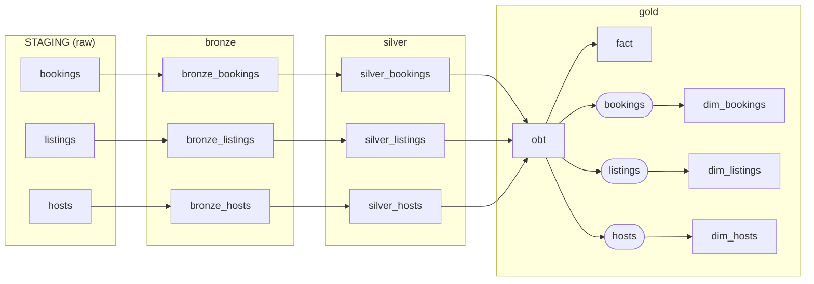

# Airbnb Analytics with dbt and Snowflake

A dbt project that turns raw Airbnb bookings, listings and hosts data in Snowflake into tested, documented gold tables. It uses a medallion architecture (bronze, silver, gold), runs across separate DEV, QA and PROD environments, and is scheduled inside Snowflake as a dbt project object.

This started as a practice project, so it also records the limitations that would need fixing before real production use. See [Known limitations](#known-limitations).

## Contents

- [Architecture](#architecture)
- [Data model](#data-model)
- [Macros](#macros)
- [Testing and contracts](#testing-and-contracts)
- [Certification](#certification)
- [Repository layout](#repository-layout)
- [Getting started](#getting-started)
- [Environments](#environments)
- [Promoting to QA and PROD](#promoting-to-qa-and-prod)
- [Deploying to Snowflake](#deploying-to-snowflake)
- [Scheduling](#scheduling)
- [Everyday commands](#everyday-commands)
- [Troubleshooting](#troubleshooting)
- [Known limitations](#known-limitations)
- [Security](#security)

## Architecture



Rounded boxes are ephemeral models, which exist only as CTEs inside the snapshots that use them.

| Layer | Schema | Purpose | Materialization |
|---|---|---|---|
| Raw | `STAGING` | Source data, loaded outside dbt | Not managed by dbt |
| Bronze | `bronze` | Unchanged copy of the raw tables | `bronze_bookings` is incremental, the others are tables |
| Silver | `silver` | Cleaned columns, business logic and hash keys | Incremental |
| Gold | `gold` | Consumer-facing wide table, fact table and history | Tables and snapshots |

Each environment has its own database with the same schema names. A custom [`generate_schema_name`](macros/generate_schema_name.sql) macro uses the configured schema name as is, so models build in `gold` and not `dbt_schema_gold`.

## Data model

### Sources

Sources are declared in [`models/sources/sources.yml`](models/sources/sources.yml). The database comes from the active target, so each environment reads its own raw data.

| Table | Columns used by this project |
|---|---|
| `STAGING.BOOKINGS` | `booking_id`, `listing_id`, `booking_date`, `nights_booked`, `booking_amount`, `cleaning_fee`, `service_fee`, `booking_status`, `created_at` |
| `STAGING.LISTINGS` | `listing_id`, `host_id`, `property_type`, `room_type`, `accommodates`, `bathrooms`, `bedrooms`, `price_per_night`, `city`, `created_at` |
| `STAGING.HOSTS` | `host_id`, `host_name`, `response_rate`, `created_at` |

### Bronze

`SELECT *` copies of each source. `bronze_bookings` loads incrementally, taking rows whose `CREATED_AT` is later than the current maximum. `bronze_listings` and `bronze_hosts` are rebuilt on every run.

### Silver

All three models are incremental, merging on `key_hash` and processing rows newer than the latest `created_at` already loaded.

| Model | Derived columns |
|---|---|
| `silver_bookings` | `total_amount`, `key_hash` |
| `silver_listings` | `city`, `price_tier`, `key_hash` |
| `silver_hosts` | `host_quality`, `key_hash` |

`total_amount` is calculated as:

```text
round((round(nights_booked * booking_amount, 2) + cleaning_fee + service_fee) * 1.01, 2)
```

### Gold

**`obt`** is one big table with one row per booking, joined to its listing and host.

| Group | Columns |
|---|---|
| Booking | `booking_id`, `listing_id`, `booking_date`, `total_amount`, `booking_status`, `created_at`, `key_hash` |
| Listing | `host_id`, `property_type`, `room_type`, `city`, `price_per_night`, `listing_created_at` |
| Host | `host_name`, `host_quality`, `host_created_at` |

**`fact`** holds keys and measures only, with one row per booking.

| Column | Type | Role |
|---|---|---|
| `booking_id` | `text` | Key to `dim_bookings` |
| `listing_id` | `number(38,0)` | Key to `dim_listings` |
| `host_id` | `number(38,0)` | Key to `dim_hosts` |
| `total_amount` | `number(38,2)` | Measure |
| `price_per_night` | `number(38,0)` | Measure |

**Snapshots** record history for each dimension. They are defined in YAML under [`snapshots/`](snapshots/) and read from the ephemeral models in `models/gold/ephemeral/`.

| Snapshot | Key | `updated_at` column | Value of `dbt_valid_to` on current rows |
|---|---|---|---|
| `dim_bookings` | `booking_id` | `CREATED_AT` | `9999-12-31` |
| `dim_listings` | `listing_id` | `LISTING_CREATED_AT` | `NULL` |
| `dim_hosts` | `host_id` | `HOST_CREATED_AT` | `NULL` |

## Macros

| Macro | What it does |
|---|---|
| `multiply(x, y, precision)` | Multiplies two SQL expressions and rounds the result. Each argument is wrapped in parentheses, so expressions are safe to pass. |
| `key_hash(columns)` | Builds a 64-bit key with Snowflake's `HASH()` from a list of columns. Always pass a list, such as `key_hash(['booking_id'])`. |
| `tag(col)` | Returns a price tier: `low` below 200, `medium` below 500, otherwise `high`. |
| `host_quality(col)` | Returns `Very Good` above 95, `Good` above 75, otherwise `Average`. |
| `trimmer(col)` | Intended to trim and uppercase a column. See [Known limitations](#known-limitations). |
| `apply_certification()` | Post-hook that tags a table in Snowflake when its `certified` flag is `true`. |
| `generate_schema_name()` | Uses custom schema names without a target prefix. |

Two Jinja rules explain most of the macro problems you are likely to hit in this project:

- Jinja runs before the query reaches Snowflake, so it only sees column names as text and never sees row values. Row-level logic has to be SQL, such as a `CASE` expression.
- Inside `{{ }}`, call macros directly and join text with `~`. A `{{ }}` nested inside a quoted string is never rendered.

```sql
{{ multiply(multiply('nights_booked', 'booking_amount', 2) ~ ' + cleaning_fee + service_fee', '1.01', 2) }}
```

## Testing and contracts

Gold model properties are in [`models/gold/properties.yml`](models/gold/properties.yml).

- **Contracts** are enforced on `fact` and `obt`. The build fails if a column name or type no longer matches the file, so every column must be listed.
- **Generic tests** cover `unique` and `not_null` on keys, `relationships` from `fact` to each dimension, and `accepted_values` on `host_quality`.
- **Singular test:** [`tests/source_test.sql`](tests/source_test.sql) checks for negative booking amounts in the source. It is set to warn, so it never blocks a build.

`dbt build` runs models, snapshots and tests in dependency order, and a failing test skips anything downstream of it.

Snapshots defined in YAML can only be described once, so any snapshot tests must go in that snapshot's own file in `snapshots/`. Adding the same snapshot to another properties file fails with a duplicate entry error. Contracts apply to models only.

## Certification

A table is treated as certified when it has:

1. A named owner and a description.
2. Passing tests on its keys and measures.
3. A fixed set of columns, enforced by a contract where possible.
4. Reviewer approval for the change that sets the flag.

The flag is set per model in `properties.yml`:

```yaml
config:
  meta:
    owner: "Sayan Adhikary"
    certified: true
```

`fact` and `obt` are currently flagged as certified. dbt does not send `meta` to Snowflake, so the `apply_certification` post-hook on the `gold` folder applies a `CERTIFICATION` tag after each build. The tag has to be reapplied every time because gold tables are recreated with `create or replace`.

Object tags require Snowflake Enterprise edition or higher. Create the tag once in each environment, after the `GOLD` schema exists:

```sql
CREATE TAG IF NOT EXISTS <database>.GOLD.CERTIFICATION ALLOWED_VALUES 'certified';
```

To check a table:

```sql
SELECT tag_name, tag_value
FROM TABLE(<database>.INFORMATION_SCHEMA.TAG_REFERENCES('<database>.GOLD.FACT', 'TABLE'));
```

## Repository layout

The Python project sits at the repository root, and the dbt project is in `SnowFlake_DBT_Practice/`.

```text
.
├── pyproject.toml                  Python dependencies, managed with uv
├── uv.lock
└── SnowFlake_DBT_Practice/
    ├── dbt_project.yml             Project and folder-level configuration
    ├── dbt_projects_profiles.yml   Profile used inside Snowflake (no secrets)
    ├── profiles.yml                Local profile, git-ignored
    ├── analyses/                   Ad hoc queries and environment setup scripts
    ├── macros/
    ├── models/
    │   ├── sources/
    │   ├── bronze/
    │   ├── silver/
    │   └── gold/
    │       ├── ephemeral/          Inputs to the snapshots
    │       ├── fact.sql
    │       ├── obt.sql
    │       └── properties.yml      Contracts, tests and ownership
    ├── snapshots/
    └── tests/
```

## Getting started

### Prerequisites

- A Snowflake account with a role that can create databases, roles and warehouses. Enterprise edition is needed for certification tags.
- Python 3.12 and [uv](https://docs.astral.sh/uv/).

### 1. Install dependencies

From the repository root:

```bash
uv sync --frozen
```

On macOS, installing onto an ExFAT external drive can fail on `._` metadata files. If that happens, keep the virtual environment on an internal disk by setting `UV_PROJECT_ENVIRONMENT`, for example to `~/.venvs/snowflake-dbt-practice`.

### 2. Create your local profile

Create `SnowFlake_DBT_Practice/profiles.yml`. It is git-ignored and must stay that way.

```yaml
SnowFlake_DBT_Practice:
  target: dev
  outputs:
    dev:
      type: snowflake
      account: "{{ env_var('DBT_SF_ACCOUNT') }}"
      user: "{{ env_var('DBT_DEV_USER') }}"
      password: "{{ env_var('DBT_ENV_SECRET_DEV_PASSWORD') }}"
      role: <your_dev_role>
      database: AIRBNB
      warehouse: COMPUTE_WH
      schema: dbt_schema
      threads: 1
    qa:
      type: snowflake
      account: "{{ env_var('DBT_SF_ACCOUNT') }}"
      user: "{{ env_var('DBT_QA_USER') }}"
      password: "{{ env_var('DBT_ENV_SECRET_QA_PASSWORD') }}"
      role: TRANSFORMER_QA
      database: AIRBNB_QA
      warehouse: WH_QA
      schema: dbt_schema
      threads: 4
    prod:
      type: snowflake
      account: "{{ env_var('DBT_SF_ACCOUNT') }}"
      user: "{{ env_var('DBT_PROD_USER') }}"
      password: "{{ env_var('DBT_ENV_SECRET_PROD_PASSWORD') }}"
      role: TRANSFORMER_PROD
      database: AIRBNB_PROD
      warehouse: WH_PROD
      schema: dbt_schema
      threads: 4
```

The `DBT_ENV_SECRET_` prefix keeps those values out of dbt's logs.

### 3. Set the environment variables

Put them in a `.env` file, which is git-ignored:

```bash
DBT_SF_ACCOUNT='<account>'
DBT_DEV_USER='<user>'
DBT_ENV_SECRET_DEV_PASSWORD='<password>'
```

dbt does not read `.env` by itself, so load it in each new terminal:

```bash
set -a; source .env; set +a
```

### 4. Load the raw data

Create a database named `AIRBNB` with a `STAGING` schema containing `BOOKINGS`, `LISTINGS` and `HOSTS`. Then create the tag from [Certification](#certification), using `AIRBNB` as the database.

### 5. Build

From `SnowFlake_DBT_Practice/`:

```bash
uv run dbt debug
uv run dbt build
```

## Environments

| Target | Database | Role | Warehouse | Setup script |
|---|---|---|---|---|
| `dev` | `AIRBNB` | Set in your local profile | `COMPUTE_WH` | None |
| `qa` | `AIRBNB_QA` | `TRANSFORMER_QA` | `WH_QA` | [`analyses/promotote_high_env.sql`](analyses/promotote_high_env.sql) |
| `prod` | `AIRBNB_PROD` | `TRANSFORMER_PROD` | `WH_PROD` | [`analyses/prod_prep.sql`](analyses/prod_prep.sql) |

Separate databases are required here. Because `generate_schema_name` uses plain schema names, two environments sharing a database would overwrite each other.

The setup scripts in `analyses/` record the steps that were run and are meant to be run by hand in a Snowflake worksheet. dbt does not execute them. They are not written to run top to bottom more than once, because some statements repeat or fail if the object already exists. In the QA script, the `GOLD` schema must exist before the tag is created.

In QA and PROD, the `STAGING` schema is a zero-copy clone of the DEV raw schema. A clone does not receive new data, so see [Known limitations](#known-limitations).

## Promoting to QA and PROD

Promotion means running the same Git commit against each environment.

1. Confirm the change works in DEV with `dbt build`.
2. Commit and push it.
3. Test the connection and build QA:
   ```bash
   dbt debug --target qa
   dbt build --target qa
   ```
4. Once QA passes, deploy that commit to PROD using the steps below.

Without `--target`, dbt uses `dev`.

## Deploying to Snowflake

PROD runs as a Snowflake dbt project object, `AIRBNB_PROD.GOLD.AIRBNB_DBT`, deployed from this GitHub repository through a Git repository stage. Runs inside Snowflake use [`dbt_projects_profiles.yml`](dbt_projects_profiles.yml), which contains no credentials because they run as the owner of the task or session.

The first-time setup is in [`analyses/prod_prep.sql`](analyses/prod_prep.sql). After pushing a change, deploy it with:

```sql
USE ROLE TRANSFORMER_PROD;
USE WAREHOUSE WH_PROD;

ALTER GIT REPOSITORY AIRBNB_PROD.GOLD.DBT_REPO FETCH;

ALTER DBT PROJECT AIRBNB_PROD.GOLD.AIRBNB_DBT
  DEPLOY FROM '@AIRBNB_PROD.GOLD.DBT_REPO/branches/main/SnowFlake_DBT_Practice';
```

To validate the deployed project without building anything:

```sql
EXECUTE DBT PROJECT AIRBNB_PROD.GOLD.AIRBNB_DBT ARGS = 'parse --target prod';
```

The task runs the deployed copy, so pushing to GitHub has no effect on PROD until you redeploy.

## Scheduling

A Snowflake task runs `dbt build --target prod` on a daily schedule. `analyses/prod_prep.sql` defines it to run at 04:00 IST:

```sql
CREATE OR ALTER TASK AIRBNB_PROD.GOLD.RUN_DBT_DAILY
  WAREHOUSE = WH_PROD
  SCHEDULE = 'USING CRON 0 4 * * * Asia/Kolkata'
AS
  EXECUTE DBT PROJECT AIRBNB_PROD.GOLD.AIRBNB_DBT ARGS = 'build --target prod';
```

The live schedule is whatever was last applied in Snowflake, so confirm it with `SHOW TASKS`.

| Action | SQL |
|---|---|
| Check the schedule and state | `SHOW TASKS LIKE 'RUN_DBT_DAILY' IN SCHEMA AIRBNB_PROD.GOLD;` |
| Run it now (a real PROD build) | `EXECUTE TASK AIRBNB_PROD.GOLD.RUN_DBT_DAILY;` |
| Pause the schedule | `ALTER TASK AIRBNB_PROD.GOLD.RUN_DBT_DAILY SUSPEND;` |
| Turn it back on | `ALTER TASK AIRBNB_PROD.GOLD.RUN_DBT_DAILY RESUME;` |

To change the time, suspend the task, run `CREATE OR ALTER TASK` with the new cron expression, then resume it.

To see recent runs:

```sql
SELECT name, state, scheduled_time, completed_time, error_message
FROM TABLE(AIRBNB_PROD.INFORMATION_SCHEMA.TASK_HISTORY(TASK_NAME => 'RUN_DBT_DAILY'))
ORDER BY scheduled_time DESC
LIMIT 5;
```

## Everyday commands

Run these from `SnowFlake_DBT_Practice/`. Prefix them with `uv run` if you installed with uv.

| Command | Purpose |
|---|---|
| `dbt debug --target qa` | Test the profile and connection |
| `dbt compile --select fact` | Render the SQL without running it, to `target/compiled/` |
| `dbt build --select fact obt` | Build the selected models and run their tests |
| `dbt build --select +fact` | Build `fact` and everything upstream of it |
| `dbt snapshot` | Run the snapshots only |
| `dbt test --select fact` | Run the tests only |
| `dbt run --select silver_bookings --full-refresh` | Rebuild an incremental model from scratch |
| `dbt docs generate && dbt docs serve` | Build and browse the documentation site |

### When a full refresh is needed

Incremental models merge into the existing table, so changing a model's columns breaks the merge until the table is rebuilt. Run with `--full-refresh` after renaming or adding a column, or after changing a calculation that should apply to older rows. Gold tables are rebuilt on every run and do not need this.

`--full-refresh` does not rebuild snapshots. A snapshot's history exists only in its table, so dropping one permanently loses that history.

## Troubleshooting

| Error | Cause | Fix |
|---|---|---|
| `'<' not supported between instances of 'str' and 'int'` | A Jinja `if` compared a column name to a number | Move the logic into a SQL `CASE` |
| `syntax error ... unexpected '{'` | A `{{ }}` nested inside a quoted macro argument | Call the macro directly and join text with `~` |
| `expected token ',', got 'string'` | A macro call and a string sit side by side | Join them with `~` |
| `invalid identifier` on an incremental model | A column changed but the table has the old shape | Run once with `--full-refresh` |
| `duplicate column name` | A bare `*` in a query with joins | Limit it to one table, such as `silver_bookings.*` |
| `syntax error ... unexpected ')'` in a snapshot | The ephemeral model is not a complete query | Add `FROM` and a final `SELECT` |
| `two schema.yml entries for the same resource` | A YAML-defined snapshot is described twice | Keep its properties in its own file |
| Contract failure on `fact` or `obt` | The query no longer matches `properties.yml` | Update the columns and types, or fix the query |
| `Incorrect username or password` | A wrong or unset credential | Check the environment variables with `dbt debug` |
| Post-hook fails on `fact` or `obt` | The `CERTIFICATION` tag is missing in that environment | Create the tag as shown in [Certification](#certification) |
| The task succeeds but no data changes | `STAGING` has no new rows | Load new raw data before the scheduled run |

A failed login counts against the user's lockout limit, and `dbt build` opens several connections at once. Fix credentials using `dbt debug`, not repeated builds.

## Known limitations

### Data correctness

- **`dim_listings` and `dim_hosts` contain duplicates.** Their ephemeral models read from `obt`, which has one row per booking, so each listing and host is repeated. Joining `fact` to either one inflates results. They are not certified. To fix this, use `SELECT DISTINCT` in both ephemeral models, drop the two snapshot tables, and run `dbt snapshot`.
- **Snapshots do not record changes.** They use `created_at` columns as `updated_at`, and these do not change after a row is created. A change such as a new `booking_status` is not captured. Use a true update timestamp or the `check` strategy.
- **`trimmer` does not clean city values.** It applies Jinja filters to the column name, so it renders as just `CITY`. It should generate SQL instead: `upper(trim({{ col }}))`.
- **Incremental models only load new rows.** They filter on `created_at`, so updates to existing rows are missed and so are late rows with older timestamps.
- **Default values for NULLs.** A NULL `price_per_night` becomes `high` and a NULL `response_rate` becomes `Average`.
- **`key_hash` can collide.** Snowflake advises against `HASH()` for unique keys, as duplicates become reasonably likely at around 4 billion rows.

### Testing

- Snapshots have no tests. Add `unique` and `not_null` on `dbt_scd_id` once the duplicates are fixed.
- Silver and bronze models have no generic tests, and there are no source freshness checks.
- The only source test is set to warn.

### Operations

- **No ingestion pipeline.** The QA and PROD `STAGING` schemas are one-time clones, so scheduled runs find no new data until something loads it.
- **Deployment skips CI/CD.** Snowflake recommends deploying directly from a Git stage only for development and testing.
- **dbt versions differ.** Local development uses 1.12.6, and the Snowflake project was created with 1.10.15.
- **`bronze_bookings` has conflicting configuration.** `properties.yml` says `table`, but the `incremental` setting in the model takes precedence.

## Security

- `profiles.yml` and `.env` hold credentials and are git-ignored. This repository is public, so check `git status` before every commit.
- Use environment variables for passwords, with the `DBT_ENV_SECRET_` prefix.
- Do not use `ACCOUNTADMIN` to run dbt. QA and PROD have dedicated roles.
- For anything beyond practice, use a dedicated service user with key-pair authentication instead of a personal password.

## Further reading

- [dbt documentation](https://docs.getdbt.com/docs/introduction)
- [dbt model governance](https://docs.getdbt.com/docs/mesh/govern/about-model-governance)
- [dbt Projects on Snowflake: deployment](https://docs.snowflake.com/en/user-guide/data-engineering/dbt-projects-on-snowflake-deploy)
- [dbt Projects on Snowflake: scheduling](https://docs.snowflake.com/en/user-guide/data-engineering/dbt-projects-on-snowflake-schedule-project-execution)
